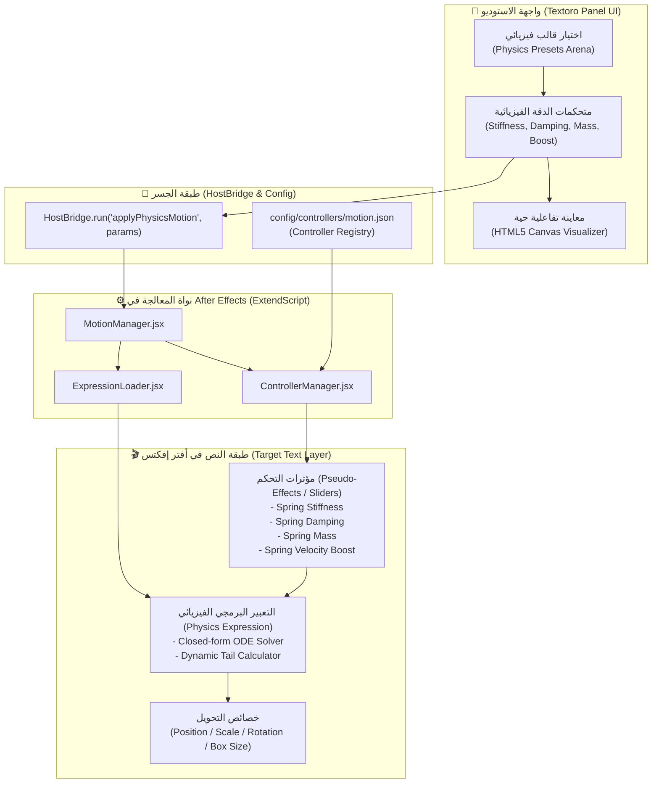

# 🚀 TEXTORO — خريطة طريق محرك الفيزياء المتقدم
## Textoro Physics Dynamics Engine (Spring & Harmonic Oscillation Architecture)

> **وثيقة معمارية وتنفيذية شاملة (Execution Roadmap & Architectural Specification)**  
> **الإصدار المستهدف:** Textoro v2.5.0  
> **النطاق:** أدوبي أفتر إفكتس (Adobe After Effects CC 2018 - CC 2025+)  
> **البيئة البرمجية:** CEP 9.0+ / JavaScript Engine & Legacy ExtendScript (ES3/ES5 Compliant)  
> **حالة المشروع:** 📋 جاهزة للتنفيذ المرحلي (Active Roadmap)

---

## 📑 فهرس المحتويات
1. [الرؤية الهندسية وأهداف المحرك](#1-الرؤية-الهندسية-وأهداف-المحرك)
2. [الأساس الرياضي والفيزيائي (Mathematical Formulation)](#2-الأساس-الرياضي-والفيزيائي-mathematical-formulation)
3. [المخطط المعماري وتدفق البيانات (System Architecture)](#3-المخطط-المعماري-وتدفق-البيانات-system-architecture)
4. [مراحل التنفيذ التفصيلية (Actionable Phases Checklist)](#4-مراحل-التنفيذ-التفصيلية-actionable-phases-checklist)
   - [المرحلة 1: نواة المعادلات التعبيرية (Analytical Expression Kernel)](#المرحلة-1-نواة-المعادلات-التعبيرية-analytical-expression-kernel)
   - [المرحلة 2: هندسة المتحكمات في أفتر إفكتس (Host Controllers & Rigging)](#المرحلة-2-هندسة-المتحكمات-في-أفتر-إفكتس-host-controllers--rigging)
   - [المرحلة 3: واجهة المستخدم وقوالب الاستوديو (UI Controls & Presets Arena)](#المرحلة-3-واجهة-المستخدم-وقوالب-الاستوديو-ui-controls--presets-arena)
   - [المرحلة 4: شاشة المعاينة التفاعلية في الوقت الفعلي (HTML5 Canvas Visualizer)](#المرحلة-4-شاشة-المعاينة-التفاعلية-في-الوقت-الفعلي-html5-canvas-visualizer)
   - [المرحلة 5: التكامل الموحد مع Typewriter و Box و Soga Live](#المرحلة-5-التكامل-الموحد-مع-typewriter-و-box-و-soga-live)
   - [المرحلة 6: الفحص الدخاني الصارم والمزامنة الحية (Smoke QA & CEP Sync)](#المرحلة-6-الفحص-الدخاني-الصارم-والمزامنة-الحية-smoke-qa--cep-sync)
5. [جدول المعاملات والقيم المعيارية (Parameter Matrix)](#5-جدول-المعاملات-والقيم-المعيارية-parameter-matrix)
6. [حزم القوالب الفيزيائية الجاهزة (Curated Physics Presets)](#6-حزم-القوالب-الفيزيائية-الجاهزة-curated-physics-presets)
7. [معالجة الحالات الحدية والمخاطر الهندسية (Edge Cases & Safety Guards)](#7-معالجة-الحالات-الحدية-والمخاطر-الهندسية-edge-cases--safety-guards)
8. [سجل متابعة الإنجاز الزمني (Milestone Progress Tracker)](#8-سجل-متابعة-الإنجاز-الزمني-milestone-progress-tracker)

---

## 1. الرؤية الهندسية وأهداف المحرك

### لماذا نحتاج إلى محرك فيزياء حقيقي بدلاً من منحنيات التسهيل التقليدية؟
في الإصدارات السابقة والأنظمة التقليدية (Bezier Easing)، يتم الاعتماد على معادلات كسرية أو متعددة حدود تكعيبية مسبقة الصنع:
- **المشكلة الأولى (القص القسري):** تنتهي الحركة قسراً عند نهاية الإطار المفتاحي (`inE` أو `outE`). إذا كان هناك ارتداد (Spring / Bounce)، فإنه إما يتوقف فجأة وبشكل قبيح أو يُضغط داخل وقت ضيق فيبدو غير طبيعي.
- **المشكلة الثانية (غياب الكتلة والقصور الذاتي):** لا يمكن للمصمم التحكم في وزن النص (`Mass`) أو قوة شد الزنبرك (`Stiffness`) أو احتكاك الهواء (`Damping`).
- **المشكلة الثالثة (انعدام استمرارية السرعة):** عند الانتقال بين حركتين أو عند وجود حركة تمهيدية، يفقد العنصر سرعته الحركية اللحظية ($v_0$).

### أهداف محرك فيزياء Textoro:
1. **محاكاة نظام الزنبرك والكتلة المخمّدة الحقيقي (Damped Harmonic Oscillator):** اعتماد حل رياضي مغلق تحليلي ($O(1)$ Analytical ODE Solution) يعمل في زمن ثابت لكل إطار دون أي بطء في الرندر أو الخط الزمني.
2. **الاستقرار المطلق:** توافق تام مع محرك ExtendScript الكلاسيكي ومحرك JavaScript الحديث في After Effects بدون أخطاء قسمة على صفر أو جذور سالبة.
3. **الامتداد الديناميكي الذكي (Dynamic Tail Settling):** استمرار ارتداد العنصر بسلاسة بعد نقطة النهاية الاسمية حتى يتلاشى الاهتزاز تحت عتبة إدراك العين ($0.001$).
4. **تكامل متناسق مع هوية الاستوديو:** إضافة لوحة تحكم دقيقة بأزرار وحقول زيرو-راديوس مدمجة ومعاينة حية فورية عبر Canvas داخل اللوحة قبل تطبيق الحركة.

---

## 2. الأساس الرياضي والفيزيائي (Mathematical Formulation)

يعتمد المحرك على المعادلة التفاضلية الخطية من الدرجة الثانية لنظام الكتلة والزنبرك والمخمد:

$$m \frac{d^2 x}{dt^2} + c \frac{dx}{dt} + k x = 0$$

حيث:
- $m$: كتلة العنصر النامي بالحركة (`Mass`)
- $c$: معامل التخميد والاحتكاك (`Damping Coefficient`)
- $k$: معامل الصلابة والشد للزنبرك (`Stiffness / Tension`)
- $x$: الإزاحة اللحظية عن نقطة الاستقرار

### 2.1 الثوابت الفيزيائية المشتقة:
1. **التردد الزاوي الطبيعي غير المخمّد (Natural Angular Frequency):**
   $$\omega_0 = \sqrt{\frac{k}{m}}$$

2. **نسبة التخميد (Damping Ratio):**
   $$\zeta = \frac{c}{2 \sqrt{k \cdot m}}$$

3. **التردد الزاوي المخمّد (Damped Frequency):**
   $$\omega_d = \omega_0 \sqrt{|1 - \zeta^2|}$$

### 2.2 الحالات الفيزيائية الثلاث (Oscillation Regimes):

```
       ▲ الإزاحة x(t)
       │         ╭───────╮
  1.0  ├─────────┼───────┼─────────── نقطة الاستقرار الهدف
       │ ╭─╮    │       ╰───╮   ╭─── Underdamped (ارتداد زنبركي)
       ││   │  │             ╰─╯
       ││    ╰─╯
       ││        ╭─────────────────── Critically Damped (أسرع وصول بدون ارتداد)
       ││       ╭╯
       ││     ╭─╯
       ││   ╭─╯
       ││ ╭─╯    ╭─────────────────── Overdamped (حركة هيدروليكية لزجة بطيئة)
  0.0  └┴────────┴─────────────────────► الزمن t
```

1. **حالة التخميد الارتدادي ($\zeta < 1$ Underdamped):**  
   الحالة الأكثر إثارة وجمالاً للموشن جرافيكس؛ يتجاوز العنصر الهدف ثم يرتد حوله تدريجياً:
   $$x(t) = 1 - e^{-\zeta \omega_0 t} \left( \cos(\omega_d t) + \frac{\zeta \omega_0 - v_0}{\omega_d} \sin(\omega_d t) \right)$$

2. **حالة التخميد الحرج ($\zeta = 1$ Critically Damped):**  
   أسرع وصول لنقطة الهدف دون أي ارتداد إطلاقاً (أسلوب الحركات السلسة في iOS):
   $$x(t) = 1 - e^{-\omega_0 t} \left( 1 + (\omega_0 - v_0) t \right)$$

3. **حالة التخميد الفائق ($\zeta > 1$ Overdamped):**  
   مقاومة لزوجة عالية تمنع أي ارتداد وتجعل الوصول هادئاً كالمكبس الهيدروليكي:
   $$x(t) = 1 - \frac{1}{2 \omega_h} \left( (\omega_h - \zeta \omega_0) e^{-(\zeta \omega_0 + \omega_h) t} + (\omega_h + \zeta \omega_0) e^{-(\zeta \omega_0 - \omega_h) t} \right)$$
   حيث $\omega_h = \omega_0 \sqrt{\zeta^2 - 1}$.

### 2.3 حساب زمن الاستقرار التلقائي (Settling Threshold):
لتجنب استمرار العمليات الحسابية للأبد ولتحديد مدة استقرار الحركة تلقائياً بدقة، يتم حساب زمن الاستقرار عند العتبة $\epsilon = 0.001$ (أي عند بقاء أقل من 0.1% من سعة الحركة):

$$t_{settle} \approx \frac{-\ln(\epsilon)}{\zeta \omega_0} = \frac{\ln(1000)}{\zeta \omega_0} \approx \frac{6.91}{\zeta \omega_0}$$

---

## 3. المخطط المعماري وتدفق البيانات (System Architecture)



---

## 4. مراحل التنفيذ التفصيلية (Actionable Phases Checklist)

### المرحلة 1: نواة المعادلات التعبيرية (Analytical Expression Kernel)
> **الهدف:** كتابة دالة حل المعادلات الفيزيائية التحليلية خفيفة الوزن ومتوافقة بنسبة 100% مع بيئة After Effects القديمة والحديثة.

- [ ] **1.1: إنشاء ملف المحرك الفيزيائي الأساسي `host/expressions/physics/spring.js`**
  - كتابة دالة `solveSpring(t, d, startVal, endVal, stiffness, damping, mass, v0)` التحليلية.
  - تطبيق فحص التخميد التلقائي للتبديل بين الحالات الثلاث: (Underdamped, Critically Damped, Overdamped).
  - التأكد من تجنب استخدام أي كلمات دلالية لـ ES6 مثل `let` أو `const` أو Arrow Functions لضمان التوافق المطلق مع محرك ExtendScript الكلاسيكي.
- [ ] **1.2: تحديث دالة التسهيل المشتركة `host/expressions/shared/easing.js`**
  - ترقية النوع `eT == 6` (Spring) من المعادلة التكعيبية الثابتة القديمة إلى استدعاء المعاملات الفيزيائية الحقيقية.
  - إضافة النوع `eT == 7` (Elastic Physics Engine) لدعم المرونة المتقدمة.
  - توفير قيم افتراضية متزنة تلقائياً في حال عدم وجود مؤثرات فيزيائية مخصصة على الطبقة (`fallback defaults`).
- [ ] **1.3: حل معضلة القص القسري (Dynamic Tail Settling)**
  - تعديل كود قراءة التوقيت `timing.js` بحيث يسمح للموقع والحجم بالاستمرار في الاهتزاز بعد نقطة `inE` أو `outE` حتى الوصول إلى $t_{settle}$.
  - دمج شرط إيقاف حسابي (`threshold cutoff`) يثبت القيمة فور هبوط سعة الارتزاز دون 0.05 بكسل لتوفير موارد كرت الشاشة والمعالج.
- [ ] **1.4: اختبار الأداء والسرعة (Benchmark Verification)**
  - اختبار سرعة المعالجة على 50 طبقة نصية متزامنة للتأكد من أن زمن تقييم الإطار أقل من $0.05\text{ms}$.

---

### المرحلة 2: هندسة المتحكمات في أفتر إفكتس (Host Controllers & Rigging)
> **الهدف:** بناء وحقن المؤثرات المنزلقة (Slider Controls) في لوحة Effect Controls في أفتر إفكتس بطريقة نظيفة وقابلة للإدارة.

- [ ] **2.1: تحديث سجل المتحكمات `config/controllers/motion.json`**
  - إضافة مجموعة متحكمات فيزيائية جديدة تحت اسم `physicsGroup`:
    - `Spring Stiffness` (قيمة افتراضية: 180، المدى: 10 إلى 800)
    - `Spring Damping` (قيمة افتراضية: 18، المدى: 2 إلى 100)
    - `Spring Mass` (قيمة افتراضية: 1.0، المدى: 0.1 إلى 10.0)
    - `Spring Velocity Boost` (قيمة افتراضية: 0، المدى: -500 إلى 500)
    - `Spring Mode Enable` (مفتاح تفعيل Checkbox)
  - تحديث معرّفات الربط في `_registry.json`.
- [ ] **2.2: ترقية `host/modules/ControllerManager.jsx`**
  - إضافة دوال إنشاء وتعيين قيم المتحكمات الفيزيائية:
    - `createPhysicsControllers(layer, values)`
    - `getPhysicsParamsFromLayer(layer)`
  - ضمان دعم الأسماء باللغتين الإنجليزية والعربية في حال كانت بيئة After Effects محلية.
- [ ] **2.3: ربط `MotionManager.jsx` و `LayerOperations.jsx`**
  - تحديث دالة `applyMotion` لدعم خيار `usePhysics: true`.
  - توليد كود التعبير البرمجي المدمج وحقنه في خصائص `Position` و `Scale` و `Rotation` مع ربط مباشر بسلايدرات التحكم.
  - الحفاظ على التوافق الرجعي: الطبقات القديمة تستمر بالعمل دون أي انهيار.

---

### المرحلة 3: واجهة المستخدم وقوالب الاستوديو (UI Controls & Presets Arena)
> **الهدف:** إتاحة تجربة استوديو أنيقة وسلسة للمصمم تمكنه من ضبط المعاملات الفيزيائية أو تطبيق قوالب جاهزة بضغطة زر واحدة.

- [ ] **3.1: تصميم درج التحكم الفيزيائي (Physics Dynamics Drawer) في `index.html`**
  - إضافة قسم قابل للطي بتصميم الاستوديو المظلم (`#161920`) تحت قسم `MOTION EASING` في تبويبي `Motion Dynamics` و `Soga Live`.
  - إضافة 3 حقول أرقام دقيقة وأشرطة تمرير زيرو-راديوس:
    - صلابة الزنبرك (`STIFFNESS / TENSION`)
    - احتكاك وتخميد الحركة (`DAMPING / FRICTION`)
    - كتلة ووزن النص (`MASS / INERTIA`)
  - الحفاظ التام على أرقام المعرّفات الـ 314 في DOM مع إدراج المعرفات الجديدة بتسميات واضحة:
    - `motionSpringStiffness`, `motionSpringDamping`, `motionSpringMass`
- [ ] **3.2: بناء منطق التفاعل في `js/panels/MotionPanel.js` و `SogaPanel.js`**
  - إظهار درج الفيزياء تلقائياً عندما يختار المستخدم منحنى `Spring` أو `Elastic` من القائمة المنسدلة الذكية.
  - إرسال الحزمة الفيزيائية الكاملة عبر `TEXTORO.HostBridge.run('applyMotion', ...)`.
  - مزامنة فورية لقيم الإعدادات مع طبقة أفتر إفكتس المحددة عند تفعيل خيار القراءة التلقائية.
- [ ] **3.3: تزويد ساحة القوالب (Presets Arena) بأزرار فيزيائية متخصصة**
  - إضافة أزرار أيقونات سريعة لتطبيق السلوكيات الفيزيائية الستة الرئيسية:
    - 🍏 **iOS Fluid** (سريع ومشدود بدون ارتداد زائد)
    - 🏀 **Bouncy Dynamic** (ارتداد كروي حيوي)
    - 🥊 **Heavy Slam** (ضربة ثقيلة ذات عطالة عالية)
    - 🍮 **Jelly Wobble** (تذبذب هلامي ناعم للنصوص اللطيفة)
    - 🏎️ **Magnetic Snap** (قفل مغناطيسي فوري فائق الشد)
    - 🌊 **Overdamped Drift** (انزلاق سينمائي ثقيل)

---

### المرحلة 4: شاشة المعاينة التفاعلية في الوقت الفعلي (HTML5 Canvas Visualizer)
> **الهدف:** تمكين المصمم من رؤية مسار الحركة ومنحنى الاهتزاز والوقت المستغرق بالملي ثانية داخل اللوحة مباشرة قبل لمس الخط الزمني.

- [ ] **4.1: تطوير مكون المعاينة `js/components/PhysicsVisualizer.js`**
  - رسم منحنى الإزاحة اللحظي $x(t)$ بدقة High-DPI Canvas وبمعدل 60 إطاراً في الثانية.
  - رسم خط نقطة الاستقرار (Target Horizon) ومناطق تجاوز الهدف (Overshoot Peaks).
  - إظهار غلاف التلاشي الأسي (Decay Envelope: $e^{-\zeta \omega_0 t}$).
- [ ] **4.2: عرض المؤشرات الرقمية الحيوية (Live Kinetic Telemetry)**
  - عرض زمن الاستقرار الفعلي: `Settling Time: 0.64s`.
  - عرض نسبة القفز: `Overshoot: +18.4%`.
  - عرض التردد التذبذبي: `Frequency: 3.2 Hz`.
- [ ] **4.3: وضع الاختبار الحركي التفاعلي (Interactive Ball / Box Playground)**
  - إضافة زر تجربة تشغيل يحاكي سقوط أو قفز مجسم تجريبي داخل الكانفاس لتوضيح الإحساس الحركي للمصمم فور تغيير أي سلايدر.

---

### المرحلة 5: التكامل الموحد مع Typewriter و Box و Soga Live
> **الهدف:** جعل الفيزياء محركاً شاملاً يعزز كافة أدوات الإضافة وليس فقط حركات التحويل المجردة.

- [ ] **5.1: فيزياء ارتداد مؤشر الآلة الكاتبة (Typewriter Elastic Caret)**
  - ربط حركة مؤشر الآلة الكاتبة بدالة ارتداد زنبركية خفيفة عند القفز من حرف لآخر لإعطاء إحساس كتابة ميكانيكي مذهل.
- [ ] **5.2: الصندوق التلقائي الفيزيائي (Dynamic Elastic Auto-Box)**
  - جعل حدود وحشو الصندوق المحيط بالنص (`BoxManager.jsx`) تتمدد بنعومة فيزيائية مرنة عند تغير أطوال الكلمات أو الأسطر.
- [ ] **5.3: المزامنة الحية مع Soga Live**
  - دعم الحركات الفيزيائية في خطوط البث الحي الفوري دون الحاجة لإعادة ضبط المفاتيح يدوياً.

---

### المرحلة 6: الفحص الدخاني الصارم والمزامنة الحية (Smoke QA & CEP Sync)
> **الهدف:** الحفاظ على استقرار الإضافة 100% والتأكد من اجتياز كافة الاختبارات الصارمة دون أي تراجع.

- [ ] **6.1: توسيع اختبارات الفحص الدخاني من 10 إلى 12 اختباراً آلياً**
  - فحص سلامة بناء الجملة لكافة ملفات التعبيرات الفيزيائية الجديدة (`Physics Expression Syntax Check`).
  - فحص تكامل سجل المتحكمات ومطابقتها لمخطط JSON (`Registry & Schema Integrity Check`).
  - التأكد من ثبات واكتمال كافة المعرّفات في DOM (`314+ Elements Non-Destruction Check`).
- [ ] **6.2: اختبار سيناريوهات الضغط والتوافق في After Effects**
  - تجربة الحالات الخاصة: (كتلة صفرية، تخميد معدوم، قيم شد قصوى).
  - التأكد من عدم ظهور تحذيرات التعبيرات الصفراء في After Effects.
- [ ] **6.3: المزامنة الحية مع دليل الإضافات في نظام التشغيل**
  - تشغيل سكربت النسخ الآمن إلى مسار `C:\Program Files (x86)\Common Files\Adobe\CEP\extensions\TEXTORO`.
- [ ] **6.4: التوثيق البرمجي والاعتماد في Git**
  - تحديث التوثيق الفني، وتسجيل Commit مفصل، وإنشاء وسم إطلاق رسمي للإصدار `v2.5.0-physics`.

---

## 5. جدول المعاملات والقيم المعيارية (Parameter Matrix)

| اسم المعامل | المعرّف البرمجي | النوع في AE | القيمة الافتراضية | المدى الموصى به | التأثير البصري الحركي |
| :--- | :--- | :--- | :---: | :---: | :--- |
| **صلابة الزنبرك** | `Spring Stiffness` | Slider | `180` | `20 – 600` | يحدد سرعة وقوة استجابة الحركة؛ القيم العالية تعطي إحساساً بمعدن مشدود جداً. |
| **معامل التخميد** | `Spring Damping` | Slider | `18` | `4 – 60` | يحدد مقدار احتكاك الهواء؛ القيم المنخفضة تزيد عدد الارتدادات، والقيم المرتفعة تكتم الحركة. |
| **كتلة العنصر** | `Spring Mass` | Slider | `1.0` | `0.2 – 5.0` | يحدد ثقل وعطالة النص؛ الكتل الكبيرة تسبب تأرجحاً أبطأ وأكثر وزناً وهيبة. |
| **دفعة السرعة الأولية** | `Velocity Boost` | Slider | `0%` | `-200% – +300%` | يحقن سرعة ابتدائية إضافية للموشن جرافيكس عالي الطاقة. |
| **عتبة الاستقرار** | `Epsilon Settle` | Constant | `0.001` | ثابت رياضي | يوقف الحسابات الرياضية فور سكون الحركة لتوفير زمن الرندر. |

---

## 6. حزم القوالب الفيزيائية الجاهزة (Curated Physics Presets)

```
┌────────────────────────────────────────────────────────────────────────┐
│                   🎯 PRESET COMPARISON SIGNATURES                      │
├──────────────────┬───────────┬─────────┬──────┬────────────────────────┤
│ Preset Name      │ Stiffness │ Damping │ Mass │ Response Character     │
├──────────────────┼───────────┼─────────┼──────┼────────────────────────┤
│ 🍏 iOS Fluid     │    280    │   26    │ 1.0  │ Snappy, Zero Overshoot │
│ 🏀 Bouncy Ball   │    190    │   11    │ 0.9  │ Playful, 3 Oscillations│
│ 🥊 Heavy Slam    │    340    │   19    │ 2.6  │ Kinetic Weight, Thud   │
│ 🍮 Jelly Elastic │    110    │    7    │ 0.8  │ Organic Wobbly Fluidity│
│ 🏎️ Magnetic Snap │    480    │   34    │ 1.1  │ Instantaneous Lock-in  │
│ 🌊 Overdamped    │    160    │   38    │ 1.4  │ Viscous Hydraulic Glide│
└──────────────────┴───────────┴─────────┴──────┴────────────────────────┘
```

---

## 7. معالجة الحالات الحدية والمخاطر الهندسية (Edge Cases & Safety Guards)

1. **حماية القسمة على الصفر أو الكتلة السالبة ($m \le 0$):**
   ```javascript
   var safeM = Math.max(0.001, mass);
   ```
2. **حماية نقطة التفرد للتخميد الحرج ($\zeta \approx 1.0$):**
   عندما تقترب $\zeta$ من $1.0$ تصبح $\sqrt{1-\zeta^2} \approx 0$ مما يؤدي إلى عدم تعيين رياضي ($NaN$). يتم معالجتها تحليلياً بالتبديل الفوري لمعادلة التخميد الحرج النقية:
   ```javascript
   if (Math.abs(zeta - 1.0) < 0.001) {
       // استخدام صيغة Critically Damped المباشرة
       return 1 - Math.exp(-w0 * t) * (1 + (w0 - v0) * t);
   }
   ```
3. **استقلالية معدل الإطارات (Framerate Independence):**
   جميع العمليات الرياضية تعمل بالثواني الحقيقية المتصلة المستخرجة من `time - inPoint`، مما يضمن تطابق الحركة بنسبة 100% سواء كانت التركيبة 24fps أو 30fps أو 60fps أو 120fps.
4. **التوافقية العكسية الصارمة (Strict Backward Compatibility):**
   إذا تم فتح مشروع قديم لا يحتوي على مؤثرات الفيزياء الجديدة، تستخدم الدوال قيماً افتراضية آمنة دون إظهار أي خطأ تعبير برمجى في After Effects.

---

## 8. سجل متابعة الإنجاز الزمني (Milestone Progress Tracker)

| المرحلة | الوصف الإجرائي | نسبة الإنجاز | الحالة | معيار القبول (Verification Gate) |
| :---: | :--- | :---: | :---: | :--- |
| **1** | نواة المعادلات التعبيرية التحليلية | `0%` | ⏳ قيد البدء | اختبار رياضي يثبت دقة حل ODE في ExtendScript |
| **2** | هندسة المتحكمات في أفتر إفكتس | `0%` | 📋 مجدولة | توليد السلايدرات بسلاسة داخل Effect Controls |
| **3** | واجهة المستخدم وقوالب الاستوديو | `0%` | 📋 مجدولة | إمكانية ضبط وتطبيق المعاملات من Panel UI |
| **4** | شاشة المعاينة التفاعلية في Canvas | `0%` | 📋 مجدولة | رسم المنحنى اللحظي 60fps داخل اللوحة |
| **5** | التكامل الموحد مع باقي الوحدات | `0%` | 📋 مجدولة | تجاوب حركة الصندوق والآلة الكاتبة بمرونة |
| **6** | الفحص الدخاني 12/12 والمزامنة الحية | `0%` | 📋 مجدولة | اجتياز 12/12 في Smoke Check ومزامنة CEP |

---

> **ملاحظة تنفيذية للمطور والمستخدم:**  
> هذه الخارطة تمثل الدستور الهندسي المرجعي لبناء محرك الفيزياء في Textoro. سيتم تنفيذ كل مرحلة بدقة تامة والتحقق منها خطوة بخطوة وتحديث بنود هذا الملف بصورة تراكمية حتى اكتمال المحرك بنسبة 100%.
