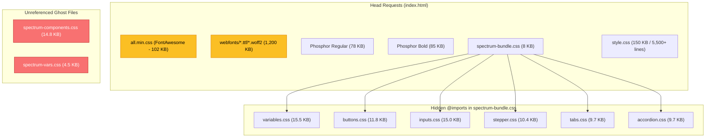
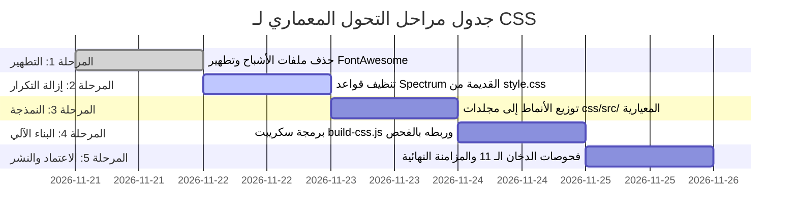

# 🎨 TEXTORO — خريطة طريق تحويل وهيكلة الـ CSS المعمارية
## High-Performance Modular CSS Architecture Roadmap (Zero-Debt & Scalable Industrial Studio)

> **وثيقة معمارية وتنفيذية شاملة (Execution Roadmap & Architectural Specification)**  
> **المشروع:** TEXTORO — Advanced Typography & Motion Engine for After Effects  
> **النطاق:** هندسة الأنماط والتصميم (CSS Architecture & Design System)  
> **البيئة البرمجية:** Adobe CEP 9.0+ / Chromium Embedded Framework (CEF)  
> **الحالة:** 📋 **جاهزة للتنفيذ (Ready for Phased Execution)**

---

## 📑 فهرس المحتويات
1. [الرؤية الهندسية وأسباب التحول المعماري (Architectural Vision)](#1-الرؤية-الهندسية-وأسباب-التحول-المعماري)
2. [تشخيص الواقع الفعلي الحالي (Current State Audit)](#2-تشخيص-الواقع-الفعلي-الحالي)
3. [جدول فرز وتصنيف ملفات الـ CSS الحالية (Triage Matrix)](#3-جدول-فرز-وتصنيف-ملفات-ال-css-الحالية)
4. [المخطط المعماري المستهدف (Target System Architecture)](#4-المخطط-المعماري-المستهدف)
5. [مراحل التنفيذ التفصيلية (Phased Implementation Roadmap)](#5-مراحل-التنفيذ-التفصيلية)
   - [المرحلة 1: التطهير وتحرير الذاكرة (Dead-Weight Triage & Purge)](#المرحلة-1-التطهير-وتحرير-الذاكرة)
   - [المرحلة 2: إزالة القواعد الميتة والمكررة (Deduplication & Dead Code Elimination)](#المرحلة-2-إزالة-القواعد-الميتة-والمكررة)
   - [المرحلة 3: النمذجة وإعادة الهيكلة المعمارية (Modular Source Refactoring)](#المرحلة-3-النمذجة-وإعادة-الهيكلة-المعمارية)
   - [المرحلة 4: بناء محرك التجميع التلقائي (Zero-Dependency CSS Bundler)](#المرحلة-4-بناء-محرك-التجميع-التلقائي)
   - [المرحلة 5: المزامنة واختبارات الجودة (Quality Assurance & CEP Sync)](#المرحلة-5-المزامنة-واختبارات-الجودة)
6. [نظام المتغيرات والتصميم القياسي (Design Tokens Specification)](#6-نظام-المتغيرات-والتصميم-القياسي)
7. [مؤشرات الأداء المستهدفة (Key Performance Indicators)](#7-مؤشرات-الأداء-المستهدفة)
8. [سجل متابعة الإنجاز الزمني (Milestone Progress Tracker)](#8-سجل-متابعة-الإنجاز-الزمني)

---

## 1. الرؤية الهندسية وأسباب التحول المعماري

### 1.1 لماذا نحتاج إلى إعادة هيكلة CSS جذرياً؟
تطورت واجهة **TEXTORO** عبر مراحل متتالية؛ وفي كل مرحلة كانت تُضاف طبقة أنماط جديدة فوق الطبقة السابقة:
* **التراكم التاريخي (Cascading Overrides):** تضخم ملف `style.css` إلى أكثر من **5,500 سطر** (150KB)، حيث يقوم النصف الثاني من الملف بإلغاء ما كُتب في النصف الأول عبر الإفراط في استخدام `!important`.
* **بطء التحميل البارد (Cold Startup):** استدعاء ملفات متعددة مع شبكة `@import` داخل `spectrum-bundle.css` ينشئ شلال طلبات (Network Waterfall) داخل محرك CEP.
* **الحجم الزائد غير المستغل (Dead Weight):** احتواء المشروع على حزمة **FontAwesome** ومجلد خطوط `webfonts/` بحجم يتجاوز **1.2 ميجابايت** رغم انتقال الواجهة بالكامل إلى أيقونات **Phosphor Bold** المحلية.
* **صعوبة الصيانة والتطوير (Maintainability Crisis):** عند الرغبة في تعديل عنصر في تبويب معين (مثل BOX أو MOTION)، يضطر المطور للبحث اليدوي بين آلاف الأسطر للتأكد من عدم وجود قاعدة متقدمة تلغي تعديله.

### 1.2 الأهداف الهندسية للتحول المعماري:
1. ✅ **التنظيم المعياري الكامل (Modular Architecture):** تقسيم الأنماط إلى ملفات مستقلة ومركزة (Tokens, Reset, Components, Panels, Utilities).
2. ✅ **صفر ديون تقنية (Zero Technical Debt):** حذف 100% من الملفات الميتة والأكواد المتكررة.
3. ✅ **ملف إنتاجي مجمّع واحد ونظيف (Single Fast Production Bundle):** تشغيل الإضافة بأقصى سرعة ممكنة عبر ملف CSS نهائي خفيف ومضغوط بدون أي استيرادات معقدة.
4. ✅ **بناء آلي ذاتي بدون تبعيات ثقيلة (Zero-Dependency Node.js Builder):** سكريبت محلي مدمج في المشروع يدمج ويتحقق من الـ CSS في أقل من 50 مللي ثانية.

---

## 2. تشخيص الواقع الفعلي الحالي



> [!WARNING]
> ملفا `spectrum-components.css` و `spectrum-vars.css` لا يتم استدعاؤهما نهائياً في المشروع؛ بينما حزمة FontAwesome وخطوطها تستهلك مساحة ضخمة بدون حاجة حقيقية.

---

## 3. جدول فرز وتصنيف ملفات الـ CSS الحالية

| مسار الملف | الحجم | الحالة الحالية | الإجراء المنهجي المطلوب |
| :--- | :---: | :---: | :--- |
| `css/spectrum-components.css` | 14.8 KB | ❌ ملف ميت (Ghost) | **حذف فوري** (غير مستدعى نهائياً). |
| `css/spectrum-vars.css` | 4.5 KB | ❌ ملف ميت (Ghost) | **حذف فوري** (غير مستدعى نهائياً). |
| `css/fontawesome/all.min.css` | 102 KB | ⚠️ فائض عن الحاجة | **استبدال المواضع المتبقية بـ Phosphor ثم الحذف**. |
| `css/webfonts/*` (8 ملفات خطوط) | 1,180 KB | ⚠️ فائض عن الحاجة | **حذف بالكامل** بعد إيقاف FontAwesome (توفير 1.2MB). |
| `css/spectrum-bundle.css` | 8.2 KB | ⚠️ استيراد قديم | **تفكيك ودمج القواعد النشطة فقط وحذف الباقي**. |
| `css/spectrum/*.css` (6 ملفات) | 72 KB | ⚠️ متجاوز بنسبة 90% | **استخلاص المتغيرات المفيدة وحذف الملفات**. |
| `css/phosphor/bold/` | 1.1 MB | ✅ نشط ومعتمد | **إبقاء أساسي** (محرك الأيقونات الرسمي المعتمد). |
| `css/phosphor/regular/` | 1.1 MB | ℹ️ نشط ثانوي | **إبقاء** كأيقونات مساعدة للواجهة. |
| `css/style.css` | 150 KB | ⚠️ ملف عملاق متضخم | **تنظيف القواعد الميتة ثم تجزئته إلى وحدات معيارية**. |

---

## 4. المخطط المعماري المستهدف

سنعتمد هيكلية **Modular Source + Compiled Single Production Bundle**:

```
css/
├── src/                                  <-- مجلد التطوير المعياري النظيف
│   ├── 00-tokens/
│   │   ├── colors.css                    (لوحة ألوان Slate Dark & Emerald Studio)
│   │   ├── typography.css                (الأحجام والخطوط والمسافات)
│   │   └── z-index.css                   (طبقات الترتيب الرأسي من الهيدر حتى القوائم)
│   ├── 01-base/
│   │   ├── reset.css                     (Zero-Radius العام وضبط الصناديق)
│   │   └── scrollbars.css                (أشرطة التمرير الصناعية الحادة)
│   ├── 02-components/
│   │   ├── topbar.css                    (الهيدر المضغوط والتبويبات العلوية 32px)
│   │   ├── actionbar.css                 (الشريط السفلي 32px وأزرار الإجراءات)
│   │   ├── precision-inputs.css          (صناديق الإدخال الرقمية المدمجة)
│   │   ├── custom-select.css             (القوائم المنسدلة الذكية Dropup/Dropdown)
│   │   ├── cards.css                     (البطاقات studio-card و soga-box)
│   │   ├── sliders.css                   (مزلاجات الحركة الدقيقة)
│   │   ├── toggle-chips.css              (رقاقات التفعيل التفاعلية)
│   │   ├── modals.css                    (النوافذ المنبثقة)
│   │   └── tooltips-context.css          (التولتيب وقوائم السياق)
│   ├── 03-panels/
│   │   ├── panel-type.css                (تخطيط تبويب النصوص والأزرار)
│   │   ├── panel-box.css                 (تخطيط تبويب البوكس والمحاذاة)
│   │   ├── panel-presets.css             (قائمة البريسات المضغوطة بارتفاع 26px والفلاتر)
│   │   ├── panel-control.css             (تبويب Soga والتحكم الحركي)
│   │   ├── panel-markers.css             (تبويب العلامات والتايملاين)
│   │   ├── panel-motion.css              (تبويب كيرفات الحركة ومحرك التسهيل)
│   │   ├── panel-physics.css             (درج محرك الفيزياء وكانفاس المحاكاة)
│   │   └── panel-config.css              (إعدادات النظام والذاكرة المؤقتة)
│   └── 04-utilities/
│       ├── grids.css                     (الشبكات الدقيقة 4 و 2 أعمدة)
│       └── spacing.css                   (الهوامش المدمجة mt-2, mt-4, mb-2, mb-4)
├── phosphor/                             <-- مجلد الأيقونات الرسمية
├── style.css                             <-- الملف المجمّع النظيف فائق السرعة
└── style.css.map                         <-- خريطة الربط لتسهيل الـ Debugging
```

---

## 5. مراحل التنفيذ التفصيلية

### المرحلة 1: التطهير وتحرير الذاكرة
- [ ] **1.1 حذف ملفات الأشباح:** حذف `css/spectrum-components.css` و `css/spectrum-vars.css`.
- [ ] **1.2 استبدال آخر بقايا FontAwesome:** استبدال الأيقونات القليلة المتبقية في:
  - `js/ui/ContextMenu.js`
  - `js/panels/PresetsPanel.js` (شاشات التحميل والحالة الفارغة)
  - `index.html` (أيقونة مسار المجلد)
  بأيقونات **Phosphor Bold** المتوافقة مع النظام.
- [ ] **1.3 إزالة FontAwesome بالكامل:**
  - حذف وسم `<link rel="stylesheet" href="css/fontawesome/all.min.css...">` من `index.html`.
  - حذف ملف `css/fontawesome/all.min.css`.
  - حذف مجلد `css/webfonts/` بالكامل وتوفير ما يزيد عن **1.2 ميجابايت**.

---

### المرحلة 2: إزالة القواعد الميتة والمكررة
- [ ] **2.1 تدقيق النصف القديم من `style.css`:** فحص الأسطر من `570` إلى `3063` (أنماط Spectrum القديمة الملغاة).
- [ ] **2.2 استئصال الأكواد الميتة (Dead Code Elimination):**
  - إزالة قواعد الـ Radius الملغاة (`border-radius: 4px`, `border-radius: 2px`).
  - إزالة قواعد الألوان والإطارات القديمة ذات التعارض مع نظام Solid Studio.
- [ ] **2.3 إيقاف `spectrum-bundle.css`:**
  - استخلاص المتغيرات الحيوية الضرورية ونقلها إلى `00-tokens/`.
  - إيقاف شلال استيراد `@import` الـ 6 ملفات من رأس `index.html`.
- [ ] **2.4 اختبار الجودة الدخاني:** التأكد من اجتياز جميع فحوصات الدخان الـ 11.

---

### المرحلة 3: النمذجة وإعادة الهيكلة المعمارية
- [ ] **3.1 إنشاء هيكل مجلد `css/src/`:** توزيع القواعد النظيفة على ملفات متخصصة وصغيرة (لا يتجاوز أي ملف 150-250 سطراً).
- [ ] **3.2 عزل مكونات الواجهة المشتركة:**
  - نقل أنماط الهيدر والتبويبات العلوية إلى `topbar.css`.
  - نقل أنماط شريط الإجراءات إلى `actionbar.css`.
  - نقل أنماط صناديق الإدخال الدقيقة إلى `precision-inputs.css`.
  - نقل أنماط القوائم المنسدلة الذكية إلى `custom-select.css`.
  - نقل أنماط البريسات المضغوطة (26px) إلى `panel-presets.css`.
- [ ] **3.3 فصل أنماط التبويبات السبعة:** تخصيص ملف مستقل لكل تبويب من التبويبات السبعة بالإضافة إلى تبويب الفيزياء.

---

### المرحلة 4: بناء محرك التجميع التلقائي (Zero-Dependency CSS Bundler)
- [ ] **4.1 كتابة سكريبت التجميع:** إنشاء `tools/build-css.js` بلغة Node.js القياسية:
  - يقرأ ملفات مجلد `css/src/` وفق ترتيب منطقي صارم.
  - يقوم بدمجها في ملف `css/style.css` الموحد للإنتاج.
  - ينشئ خريطة المصدر `css/style.css.map` لتمكين فحص العناصر في Inspect Element مباشرة باسم الملف الأصلي ورقم السطر.
  - يعمل في زمن لا يتعدى **50ms**.
- [ ] **4.2 إضافة وضع المراقبة (Watch Mode):** دعم خيار التحديث الحي أثناء التطوير (`node tools/build-css.js --watch`).
- [ ] **4.3 دمج التجميع مع الفحص الدخاني:** ربط سكريبت التجميع التلقائي مع `run-smoke-checks.ps1` ليتم تجميع الملف وفحصه في خطوة واحدة قبل أي إطلاق.

---

### المرحلة 5: المزامنة واختبارات الجودة
- [ ] **5.1 فحص عدم الانكسار البصري:** مراجعة كافة التبويبات للتأكد من مطابقتها التامة للواجهة المضغوطة والتصميم الداكن الخالي من الزوايا الدائرية.
- [ ] **5.2 تشغيل الفحص الدخاني الكامل:** التحقق من نجاح الـ 11 اختباراً آلياً.
- [ ] **5.3 المزامنة الحية:** تشغيل Robocopy لمزامنة التحديثات فوراً مع مجلد لوحة أدوبي في CEP.
- [ ] **5.4 حفظ التغييرات وتوثيقها:** Commit رسمي إلى Git وتحديث `CHANGELOG.md`.

---

## 6. نظام المتغيرات والتصميم القياسي (Design Tokens)

سيتم توحيد الألوان والقياسات في [colors.css](file:///C:/Users/User/Documents/TEXTORO/css/src/00-tokens/colors.css) وفق الجدول القياسي التالي:

```css
:root {
    /* Background Surfaces */
    --bg-base:        #0c0c10;  /* خلفية اللوحة الأساسية */
    --bg-card:        #16161f;  /* خلفية البطاقات والحاويات */
    --bg-card-hover:  #1d1d28;  /* حالة التمرير على البطاقات */
    --bg-input:       #181822;  /* خلفية حقول الإدخال */
    --bg-input-hover: #1f1f2c;  /* حالة التمرير على الحقول */
    --bg-header:      #111116;  /* ترويسة اللوحة والشريط السفلي */

    /* Accent & Brand Colors */
    --accent-emerald: #10b981;  /* اللون الأخضر الزمردي النشط */
    --accent-hover:   #34d399;  /* تفاعل اللون الزمردي */
    --accent-active:  #059669;  /* نقر الزر النشط */
    --accent-danger:  #ef4444;  /* اللون الأحمر لحالات الحذف والتحذير */

    /* Typography & Icons */
    --text-primary:   #ffffff;  /* نصوص العناوين والقيم */
    --text-secondary: #9898aa;  /* نصوص التسميات والتلميحات */
    --text-muted:     #68687a;  /* النصوص الثانوية والوحدات */

    /* Studio Compact Metrics */
    --header-height:  32px;     /* ارتفاع الهيدر والشريط السفلي */
    --tab-btn-size:   26px;     /* مقاس أزرار التبويبات */
    --preset-row-h:   26px;     /* ارتفاع صف القالب */
    --border-radius:  0px;      /* صفر راديوس مطلق */
}
```

---

## 7. مؤشرات الأداء المستهدفة (Key Performance Indicators)

| المؤشر (Metric) | قبل التطبيق (Current) | بعد التطبيق المستهدف (Target) | نسبة التحسين |
| :--- | :---: | :---: | :---: |
| **إجمالي حجم ملفات CSS والخطوط** | 1.85 MB | **~350 KB** | **تخفيض 81%** في الوزن |
| **عدد ملفات CSS المستدعاة في index.html** | 5 ملفات + 6 استيرادات | **ملفان فقط** (Phosphor + style.css) | **إلغاء 80%** من الطلبات |
| **عدد أسطر ملف style.css** | 5,539 سطر | **~1,400 سطر مجمّع ونظيف** | **تقليص 75%** في التعقيد |
| **استخدام `!important` القسري** | 180+ مرة | **أقل من 15 مرة** (للحالات القصوى فقط) | بنية نقية تتبع الـ Cascading الطبيعي |
| **زمن استجابة وبناء CSS** | تعديل يدوي معقد | **تجميع آلي في < 50ms** | إنتاجية فورية وتطوير آمن |

---

## 8. سجل متابعة الإنجاز الزمني



> **تعهد الجودة:** يضمن هذا التحول الحفاظ الكامل على كافة المعرفات (314+ DOM IDs)، والتوافق الصارم مع محرك After Effects القديم والحديث، مع الوصول إلى أعلى معايير النظافة البرمجية وقابلية الصيانة والتوسع المستقبلي.
