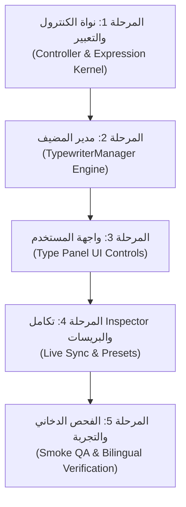

# 🚀 خطة بناء وتكامل تأثير الضبابية السينمائي (Kinetic Typewriter Blur)
## TEXTORO Typewriter Engine - Blur Reveal Architecture Specification

> **الوثيقة المعمارية والتنفيذية:** `TEXTORO_TYPEWRITER_BLUR_EFFECT_PLAN.md`  
> **الإصدار المستهدف:** TEXTORO v1.2.0 (Kinetic Typography Core)  
> **البيئة المستهدفة:** Adobe After Effects CC 2020 - CC 2025+  
> **الهدف الهندسي:** بناء تأثير ضبابية سينمائي ناعم ينبثق منه كل حرف/كلمة أثناء الكتابة، متوافق 100% مع أنظمة الصندوق الذكي، الحركة، الفاحص الحي، واللغتين العربية والإنجليزية.

---

## 1. الرؤية الفنية والفيزيائية للتأثير (Visual & Physical Dynamics)

### كيف يعمل التأثير بصرياً؟
- أثناء حركة الكتابة (سواء بالسرعة التلقائية المعتمدة على الماركرز `IN_START / IN_END` أو التقدم اليدوي `TW Progress`):
  1. كل حرف أو كلمة جديدة تولد عند رأس الكتابة بدرجة ضبابية قابلة للضبط (افتراضياً $25\text{px}$).
  2. خلال جزء من الثانية (أثناء تقدم السطر نحو الحرف التالي)، تتلاشى الضبابية بانسيابية لتستقر عند الحدة الكاملة ($0\text{px}$).
  3. الحروف المكتوبة سابقاً تظل حادة ومستقرة تماماً.
  4. في النص العربي، لا تنفصل وصلات الحروف (Cursive Ligatures) بفضل الحفاظ على محرك HarfBuzz ورمز ZWJ.

```
[ الحروف المستقرة ] ──────► [ الحرف النشط حالياً ] ──────► [ المؤشر ]
    "TEXTOR"                 "O" (Blur: 25px → 0px)             "|"
  (Sharp: 0px)                  (انتقال بؤري ناعم)            (وامض)
```

---

## 2. مصفوفة التوافقية مع أنظمة الإضافة (Cross-System Matrix)

| النظام الداخلي | آلية التكامل الهندسي | ضمان عدم التعارض |
|---|---|---|
| **نظام الصندوق (`BoxManager`)** | الصندوق يقيس أبعاد الجليف عبر `sourceRectAtTime()` | خاصية `ADBE Text Blur` لا تغير أبعاد الجليف هندسياً، فالصندوق يتمدد حرفاً بحرف بثبات ودون أي اهتزاز في الـ Padding. |
| **نظام الحركة (`MotionManager`)** | محرك Motion In/Out والفيزياء الزنبركية | يُنشأ الـ Animator باسم مستقل ومحمي `"Type Blur"` داخل مجموعة `ADBE Text Animators`، بعيداً عن Transform الطبقة ومؤثرات الحركة. |
| **محرك العربية والإنجليزية (`RTL / LTR`)** | تحديد الحرف المستهدف بالفهارس المنطقية (Logical Indexing) | سواء كان النص LTR أو RTL، يتم دائماً إلحاق الحرف في نهاية السلسلة المعروضة، مما يجعل النطاق المستهدف متطابقاً تماماً مع رأس الكتابة. |
| **الفاحص الحي (`InspectorManager`)** | إضافة متحكم `Type Blur` إلى سجل الكنترول المركزي | يقرأ الفاحص سلايدر `Type Blur` فور تحديد الطبقة ويتيح تعديل قيمته حياً في الوقت الفعلي. |
| **نظام البريسات (`PresetManager`)** | تضمين خاصية `typeBlur` في بنية الـ JSON للبريسيت | دعم الحفظ والتصدير والاستيراد عبر ملفات `.txpreset` دون كسر البريسات القديمة بفضل نظام الـ Fallback. |
| **نظام الإزالة النظيفة (`_removeTypewriter`)** | إزالة Animator ومتحكمات الـ Blur عند إزالة التأثير | تنظيف شامل يمنع بقاء أي عناصر شبحية على الطبقة. |

---

## 3. المعمارية البرمجية ومراحل التنفيذ (Actionable Phases)



---

###  المرحلة 1: نواة الكنترول والـ Expression (Core Rigging)

1. **تسجيل المتحكم في `config/controllers/typewriter.json`:**
   - إضافة متحكم جديد باسم `"Type Blur"`:
     ```json
     "Type Blur": {
       "type": "slider",
       "default": 0,
       "min": 0,
       "max": 100,
       "unit": "pixels",
       "group": "mode",
       "description": "شدة الضبابية أثناء ظهور الحروف",
       "descriptionEn": "Blur intensity on character appearance"
     }
     ```
2. **بناء تعبير نطاق الضبابية (Range Selector Expression):**
   - إنشاء تعبير متخصص في مجلد `host/expressions/typewriter/v1.4/blurRange.js`:
     - يقوم بحساب النطاق النسبي لآخر حرف أو كلمتين معروضتين بناءً على طول السلسلة النصية الحالية وموقع المؤشر.
   - كود تعبير قيمة الضبابية:
     - يربط المحور الأفقي والعمودي للضبابية بقيمة السلايدر:
       `var b = effect("Type Blur")(1).value; [b, b];`

---

### المرحلة 2: التحديث في محرك المضيف (`TypewriterManager.jsx`)

1. **إضافة دالة إنشاء Animator الضبابية `_createTypeBlurAnimator(animators, fx, blurValue)`:**
   - التحقق من وجود الـ Animator أو إنشائه:
     ```javascript
     var blurAnim = animators.addProperty("ADBE Text Animator");
     blurAnim.name = "Type Blur";
     var blurSel = blurAnim.property("ADBE Text Selectors").addProperty("ADBE Text Selector");
     // ربط البداية والنهاية بالحرف النشط
     ```
   - إضافة خاصية `ADBE Text Blur`:
     ```javascript
     var blurProp = blurAnim.property("ADBE Text Animator Properties").addProperty("ADBE Text Blur");
     blurProp.expression = 'var b = 0; try { b = effect("Type Blur")(1).value; } catch(e) { b = 0; }; [b, b];';
     ```
2. **تحديث دالة `_applyTypewriter`:**
   - تمرير خيار `opts.typeBlur` (الافتراضي: `0` = معطل، أو قيمة رقمية موجبة).
   - إضافة متحكم `"Type Blur"` إلى مصفوفة `controllerValues` لإنشائه عبر `ControllerManager` مع Fallback مباشر في حال الغياب.
3. **تحديث دالة `_removeTypewriter`:**
   - إضافة `"Type Blur"` إلى مصفوفة الكنترولات المحذوفة.
   - إضافة `"Type Blur"` إلى قائمة أسماء الـ Animators التي يتم مسحها (`removeAnimatorsByName`).

---

### المرحلة 3: واجهة المستخدم (Type Tab UI Controls)

1. **إضافة تحكمات الضبابية في `index.html` (تبويب Type):**
   - تصميم عنصر تحكم مدمج بزوايا زيرو-راديوس يتماشى مع هوية الاستوديو:
     - **Toggle / Button:** زر تفعيل سريع `Blur Reveal`.
     - **Slider:** سلايدر `Type Blur` بقيم من `0` إلى `50px` مع كبسولات ضبط سريع (`Off` | `Soft 15px` | `Cinematic 25px` | `Heavy 40px`).
2. **ربط الواجهة في `js/panels/TypewriterPanel.js`:**
   - قراءة قيمة السلايدر عند الضغط على "Apply".
   - مزامنة القيمة عند الاستدعاء من `syncFromLayer`.

---

### المرحلة 4: تكامل الفاحص والبريسات (Inspector & Presets)

1. **تحديث `js/panels/InspectorPanel.js`:**
   - التعرف على سلايدر `"Type Blur"` وعرضه ضمن مجموعة Typewriter لتمكين التعديل المباشر الحي دون إعادة تطبيق التأثير.
2. **تحديث `host/modules/PresetManager.jsx`:**
   - حفظ قيمة `typeBlur` في ملفات البريسيت، مع Fallback لقيمة `0` عند فتح بريسات قديمة لضمان التوافق العكسي بنسبة 100%.

---

### المرحلة 5: الفحص الدخاني والتحقق العملي (Smoke QA & Verification)

1. **تحديث وتوسيع أدوات الفحص الدخاني (`tools/smoke/`):**
   - التحقق من عدم وجود تضارب في المعرفات العالمية (Host Globals).
   - التحقق من توافقية الكود المكتوب مع معيار ES3 الصارم في ExtendScript.
   - تشغيل `run-smoke-checks.ps1` واجتياز كافة الفحوصات بنسبة 100%.
2. **الاختبار الحي على After Effects:**
   - اختبار نص إنجليزي خالص (LTR).
   - اختبار نص عربي متصل مع تشكيل (RTL).
   - اختبار نص مختلط (عربي + إنجليزي).
   - اختبار تزامن الصندوق الخلفي أثناء كتابة النص بالضبابية للتأكد من عدم اهتزاز الحواف.

---

## 4. جدول المعايير الفنية (Parameter Matrix)

| المعامل | النوع | القيمة الافتراضية | النطاق الموصى به | التأثير في AE |
|---|---|:---:|:---:|---|
| **Type Blur** | Slider | `0` (معطل) | `0` إلى `50px` | مقدار التشويش الضبابي اللحظي للحرف المكتوب |
| **Blur Mode** | Selector | `Character` | `Character` أو `Word` | تطبيق الضبابية على الحرف بمفرده أو الكلمة كاملة |
| **Decay Ramp** | Expression | `100%` | ثابت انسيابي | تلاشي الضبابية بسرعة مع حركة المؤشر |
